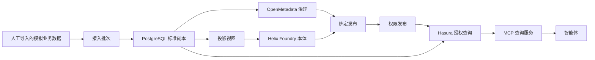

# 数据治理与本体集成中台（DGO Hub）

一个把业务数据治理和业务语义放在同一条链路、供智能体查询的中台项目。

**定位：** 上游业务数据先进入中台标准副本，完成元数据治理、本体定义和行列权限后，智能体只通过授权查询使用这份副本。当前阶段的数据来源是**人工导入的模拟业务数据**；连接真实 CRM、订单系统或现场智能体环境是以后的现场适配，不作为平台开发或平台验收的前置条件。

本项目不重写上游开源产品，而是新增一个集成层，把三件已选定的产品接成一条可追踪的链路。

## 一句话目标

让数据管理员把已批准的模拟业务数据导入中台副本，完成元数据治理、本体定义和行列权限发布，使智能体通过授权查询读取本人或本范围的数据，并返回可追溯的业务口径、同步状态和查询结果。

## 为什么是「治理 + 语义」，而不是「接一个 CRM」

| 这个项目的职责 | 不是它的职责 |
|---|---|
| 业务数据进入标准副本，保留来源键、版本、幂等和审计 | 回写源系统、订单审批、付款、CRM 任务创建 |
| OpenMetadata 管理目录、质量、血缘和口径 | 用 OpenMetadata 直接存业务明细 |
| Helix Foundry 管理业务对象、关系和已发布本体定义 | 用 Helix 决定销售查询权限 |
| Hasura 按身份执行行列权限 | 让页面「已保存」等同于权限「已生效」 |
| MCP 给智能体授权查询及语义 / 元数据信息 | 开放任意 SQL、任意 GraphQL 或通用透传工具 |
| 区分平台验收与现场验收 | 用合成数据冒充真实系统已连通 |

客户、订单、订单明细只是首期参考业务域和导入样例，不是必须存在的外部产品。

## 技术组合与引用的开源产品

| 组件 | 角色 | 当前基线 |
|---|---|---|
| [OpenMetadata](https://www.open-metadata.org/) | 元数据目录、分类、质量、血缘、口径 | `2.0.6-release`（`a695261b19d48411a39502a5c5fc0b453729eb4e`） |
| [Helix Foundry](https://github.com/helixml/helix) | 本体类型、关系、提案校验与发布 | `00d7927d7c08e16c58316e006959f052427e7fa1` |
| [Hasura GraphQL Engine](https://hasura.io/) | 按 JWT 身份执行行列查询权限 | V2 `v2.51.1`（`2b130a135659026ff6eda42c1df5722f123fd84e`） |
| PostgreSQL | 标准业务副本与控制 Schema 的存储 | 版本以部署 lock 记录为准 |
| Hermes（外部部署） | 第一个消费方，经 MCP 查数 | 现场运行时，本仓库不含其核心 |

二开边界：OpenMetadata 主要增加 UI / 导航与 API 适配；Helix 增加强制 Bearer 和最小适配；Hasura 只配置、不 fork 引擎；Hermes 不修改核心 runtime。

## 架构



导入不是绕过中台直接改标准表；它与将来的库表 ETL 共用同一套标准对象、来源键、版本和幂等规则。

## 两级验收

| 级别 | 证明什么 | 数据来源 |
|---|---|---|
| 平台验收 | 副本、治理、语义、权限、智能体查询闭环成立 | 可重复导入的模拟业务数据 + 至少两个不同数据范围的测试身份 |
| 现场验收 | 某个真实业务库和某个智能体运行时已接入 | 业务 Owner 批准的真实库与现场运行时 |

平台验收通过，不表示真实 CRM / 订单库已连通；现场未接入，只记录现场未接入，不推翻平台验收。

## 文档导航

| 目的 | 文档 |
|---|---|
| 产品定义（当前有效） | [docs/数据治理与本体集成中台_产品定义修正补充说明_v1.0.fixture.md](docs/数据治理与本体集成中台_产品定义修正补充说明_v1.0.fixture.md) |
| 完整架构与需求单元 | [docs/数据治理与本体集成中台_产品架构与二开说明_v1.0.md](docs/数据治理与本体集成中台_产品架构与二开说明_v1.0.md) |
| 实施状态 | [docs/execution/alpha1/status.md](docs/execution/alpha1/status.md) |
| 实施计划 | [docs/plans/](docs/plans/) |
| OpenMetadata UI 扩展 | [docs/OpenMetadata_UI扩展规格说明_v1.0.md](docs/OpenMetadata_UI扩展规格说明_v1.0.md) |

冲突时以修正补充说明第 4 节为准。

## 本仓库包含什么

| 目录 | 内容 | 说明 |
|---|---|---|
| `docs/` | 产品定义、计划、执行证据 | 不表示产品已完成部署 |
| `integration-service/` | 集成层可运行原型（Node.js 24 + TypeScript） | 详见该目录 README |
| `deploy/alpha1/` | Alpha.1 本地 Compose 运行与隔离探针 | 本地验证用，非生产交付 |

`integration-service` 内的主要模块：

| 模块 | 职责 |
|---|---|
| `source-registry/` | 导入来源、字段映射、Owner 批准与激活 |
| `ingestion-api/` | 接收模拟导入批次、管理 API |
| `etl-worker/` | 从来源库或导入批次抽取到标准副本，含恢复与水位 |
| `normalization/` | 标准客户 / 订单 / 明细模型、版本、幂等、客户映射、整单事务 |
| `ontology-binding/` | Helix 已发布模型与 OpenMetadata 资产核验 |
| `permission-publish/` | Hasura 行列权限的草稿、审批与发布 |
| `sales-mcp/` | 面向智能体的固定授权查询工具 |
| `migrations/` | 版本化数据库迁移 |

## 快速开始（本地验证）

需要 Docker Compose 与 Node.js 24。服务只读取显式注入的环境变量，不自动加载 `.env`。

```powershell
cd integration-service
npm ci
npm test
npm run build
```

本地运行 Alpha.1 隔离环境见 [deploy/alpha1/README.md](deploy/alpha1/README.md)；该环境使用合成 OIDC 与模拟数据，不代表生产连通。

## 实施状态（2026-10-29）

当前分支 `feat/alpha1-implementation`。M0 身份与隔离边界、M1 来源导入的多个子任务已通过本地独立工程审查；整个 M1 尚未收口，M2–M6 未开始。产品级验收仍为 NOT_RUN，生产部署仍为 BLOCKED。详细逐任务状态以 [docs/execution/alpha1/status.md](docs/execution/alpha1/status.md) 为准，本文不重复列证据。

## 给后续实现代理的读取规则

1. 先读修正补充说明，再读完整 PRD；两者冲突时采用补充说明第 4 节。
2. 当前任务使用模拟导入数据完成，不探测、不连接、不索取真实 CRM。
3. 不把 `NOT_RUN`、现场未接入或缺少外部地址当成平台失败，也不要为此补造外部连接。
4. 未经批准，不提交、不推送、不宣布阶段完成。
