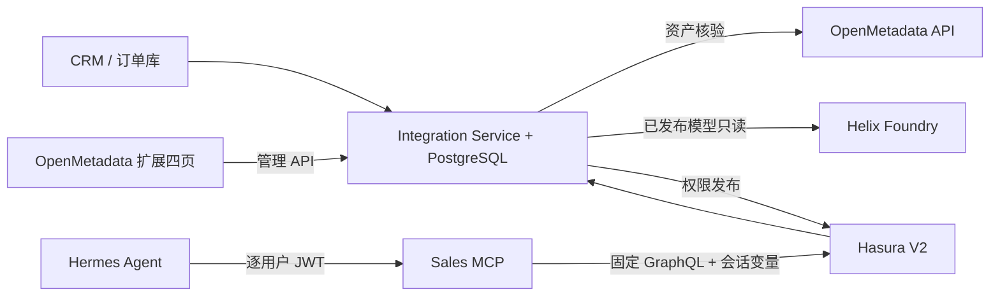

# OpenMetadata 中台页面扩展规格说明（评审稿 v1.0）

**产品：** 数据治理与本体集成中台　**日期：** 2026-10-23　**适配基线：** OpenMetadata `2.0.6-release`、Hasura `v2.51.1`、Helix Foundry `00d7927d7c08e16c58316e006959f052427e7fa1`。  
**模板状态：** 用户确认稍后提供 `需求PRD工程模板.md`，本稿先按通用“目标—范围—架构—页面—接口—权限—验收”结构编写；收到模板后可再对齐专有字段。

## 1. 产品目标与范围

在 OpenMetadata 导航中增加四个业务治理入口，汇集主 PRD 附录 B 的 P02–P04（业务数据接入）、P06–P07（本体绑定）、P08–P09（数据权限）和 P10–P11（Agent 服务）。让数据管理员能查看 CRM/订单接入状态、核验 Helix 已发布本体与物理字段、设计和发布 Hasura 行列权限、观察 Hermes 销售 MCP 服务。首期销售查数只读。页面本身不直接访问业务数据库、Hasura Admin Secret 或 Helix 写接口，均调用中台管理 API；OpenMetadata 原有资产详情仍负责通用元数据、血缘和质量展示。

**目标用户：** 数据接入管理员、本体建模员、权限审批人、Agent 运维员、只读审计员。  
**验收结果：** 一笔 CRM 客户和一笔整单经 REST/ETL 入库后，可追溯任务和水位；绑定可验证；权限发布后 Hasura 仅返回授权行列；Hermes MCP 五工具可查，审计可追踪；错误可定位且可重试。

## 2. 系统与页面边界

**路由建议：** `/governance/ingestion`、`/governance/ontology-bindings`、`/governance/data-permissions`、`/governance/agent-services`。在 OpenMetadata 前端侧注册导航项和路由，以独立模块封装 API 客户端；后端集成服务部署在同源代理或受信网关后。页面不持有源库密码、Hasura Admin Secret、Helix 令牌。现有 OpenMetadata 的角色/团队身份应由网关换成中台可验证的用户与角色，演示代码中的共享管理 key 和 `x-actor` 不能直接用于生产。

## 3. 全局交互与状态

| 状态 | UI 表示 | 处理 |
|---|---|---|
| 加载/空数据 | 骨架屏、空态说明 | 明确区分“没有任务”和“接口不可用” |
| 部分上游不可用 | 黄色横幅，显示系统与时间 | 保留最近成功快照；禁止误报已验证 |
| 写入/发布中 | 禁止重复提交，显示请求编号 | 提交后刷新单条状态；超时先查状态再重试 |
| 验证失败 | 红色状态与可复制错误码 | 显示失败字段、条件和修复指引，敏感值打码 |
| 权限漂移/撤权失败 | 红色阻断状态 | 禁用 Agent 服务入口，并由运维执行恢复流程 |

所有列表支持按时间、来源、状态筛选，默认显示最近 24 小时，分页不超过 100 条。操作按钮有权限校验；页面只能展示服务端返回的授权结果，不能仅靠前端隐藏按钮做鉴权。审计至少记录操作人、对象、修订号、时间、结果与请求关联号。任何预览用的用户标识必须清楚标注是“模拟身份”。

## 4. 页面 P1：业务数据接入

**入口与职责：** 在 OpenMetadata“治理”导航下查看 REST/ETL 接入链路，定位 CRM/订单同步失败，并发起安全重试。  
**页面区块：** 总览卡（今日成功/失败、最新水位、待处理钩子）、任务表、失败详情抽屉、源系统与字段映射只读面板、重试确认面板。

| 字段/操作 | 说明 |
|---|---|
| 来源、模式、任务/事件 ID | `crm`/`orders` 等；REST 或 ETL；可复制追踪 ID |
| 接收时间、处理时间、状态 | `applied`、`duplicate`、`stale`、`failed`；明确“重复”不是新写入 |
| 水位 | `(last_updated_at,last_source_id)`；显示时区和延迟 |
| 失败原因 | 校验、客户映射缺失、源库不可达、钩子失败分组；原始 payload 不在列表显示 |
| 重试 | 只针对失败 ETL 源或可重放事件；确认前显示可能的重复与版本语义 |

**数据 API：** `GET /admin/ingestion/events`、`GET /admin/ingestion/failures`、`GET /admin/etl/watermarks`、`POST /admin/etl/:source/retry`。生产版还需任务详情与分页接口、隔离队列重放接口；当前验证代码仅支持水位重试，不支持直接从失败记录重放 payload。

**验收：** 重放同事件显示 `duplicate`；订单总额错误在失败列表有原因且不移动水位；修复后 worker 继续推进；错误详情不泄露完整邮箱/电话。

## 5. 页面 P2：本体绑定

**职责：** 将 Helix 已发布对象类型与 OpenMetadata 物理资产、字段和关系建立可审阅映射。页面不通过 Helix 查询销售明细，不修改 Helix 发布状态。

| 区块 | 内容与动作 |
|---|---|
| 已发布模型 | 工作区、对象类型、发布版本/时间、资源 ID、关系摘要；上游不可用时显示最后成功读取时间 |
| 物理资产选择 | 搜索 OpenMetadata 表 FQN，展示字段、类型、标签和资产链接 |
| 字段映射编辑 | 业务属性→物理列，列不存在、类型不兼容、敏感标签缺失即阻止验证 |
| 关系映射 | 源对象、目标对象、连接键、基数；客户→订单必须有可验证的客户映射键 |
| 验证与状态 | 草稿、已验证、失效；展示 Helix 版本、OpenMetadata 表 ID、Hasura 视图及校验结果 |

**数据 API：** `GET /admin/ontology/helix`、`GET/POST /admin/ontology/bindings`。当前代码已验证 Helix 活动代次中对象类型存在且物理列存在，并记录代次；类型兼容、关系基数和版本变更自动失效仍是二开验收项。Helix 读取使用 `/api/v1/workspaces/:id/overview` 中的活动发布代次与 `objectType` 资源；OpenMetadata 读取使用 `/api/v1/tables/name/{fqn}`。Helix 返回结构应以部署实例 `/api/docs` 为准。

**验收：** 未发布对象不得作为有效绑定；不存在的列阻止保存；Helix 发布版本变化后标记“待复验”；物理表或字段删除后标记失效且不影响已有订单数据完整性。

## 6. 页面 P3：数据权限

**职责：** 设置角色、行条件、列白名单、脱敏视图，预览后经独立审批发布到 Hasura。主 PRD 业务角色为 `sales`、`sales_manager`；演示代码当前仅实现 `sales_reader` 的本人范围，应在正式二开时替换为按角色与部门授权的发布模型。租户条件由系统锁定，页面不能输入任意 SQL/GraphQL 表达式。

| 区块 | 必备功能 |
|---|---|
| 策略列表 | 对象、角色、修订号、草稿/已审批/已发布/失败、生效时间、发布错误 |
| 策略编辑 | 从允许表/视图选列；不得选择原始邮箱、电话等敏感列；脱敏视图预览 |
| 行条件 | 用自然语言和结构树展示 `tenant_id = 当前租户 AND owner_user_id = 当前用户`；不可自由改写 |
| 预览 | 输入测试租户/用户，返回拟授权列和预估行数；醒目标注“预发布估算”，发布后用 Hasura 复验 |
| 审批/发布 | 创建人与审批人不同；发布操作展示前后差异、目标 Hasura、执行回执与一致性状态 |

**数据 API：** `GET/POST /admin/permissions`、`POST /admin/permissions/preview`、`POST /admin/permissions/:id/approve`、`POST /admin/permissions/:id/publish`。样例 Publisher 已用 `export_metadata` 资源版本与 `replace_metadata` 原子更新，并核查 `get_inconsistent_metadata` 和读回权限；发布接口返回排队状态。生产版还需撤权、回滚、漂移检测和多实例发布锁。规则生效由 Hasura 实际查询验证，不以“保存成功”替代。

**验收：** `sales` 只见本人客户/订单，`sales_manager` 只见本部门；不同租户互相隔离；未经白名单列 GraphQL 请求失败；创建人不能自审；发布失败显示错误并进入关闸/修复流程。

## 7. 页面 P4：Agent 服务

**职责：** 查看 MCP 工具与说明、某用户授权范围、调用审计和近期错误，辅助 Hermes 销售专家排障。

| 区块 | 内容 |
|---|---|
| 工具目录 | 五工具名称、用途、输入字段、只读标识、版本与最近成功时间 |
| 授权范围 | 按用户/租户查询角色、行条件、列范围、生效修订号；不得展示 JWT 原文 |
| 调用审计 | 时间、用户、租户、工具、耗时、结果、错误码；不记录原始查询结果和敏感参数 |
| 最近错误 | 身份失效、Hasura 拒绝、权限漂移、上游超时；提供关联请求编号和排查入口 |

**数据 API：** `GET /admin/agent/tools`、`GET /admin/agent/scope/:userId?tenantId=...`、`GET /admin/agent/audit`、`GET /admin/agent/errors`。当前代码的范围接口展示规则与策略记录，生产版需要接入企业身份授权组、令牌吊销状态和生效版本核验。MCP 入口与页面管理 API 独立，不允许通过本页面直接以管理员身份调用业务 GraphQL。

**验收：** 逐用户短时 JWT 能调用五工具；过期/错误角色返回未授权；一次查数留下审计；跨用户数据不泄露；错误只显示错误码及必要诊断信息。

## 8. 页面角色、流程与接口契约

| 角色 | P1 | P2 | P3 | P4 |
|---|---|---|---|---|
| 数据接入管理员 | 查看/重试 | 只读 | 只读 | 只读 |
| 本体建模员 | 只读 | 编辑/验证 | 只读 | 只读 |
| 权限设计员 | 只读 | 只读 | 草稿/预览 | 只读 |
| 权限审批员 | 只读 | 只读 | 审批/发布 | 只读 |
| Agent 运维员 | 只读 | 只读 | 只读 | 查看范围/审计/错误 |
| 审计员 | 只读 | 只读 | 只读 | 只读 |

**状态流：** 接入 `received → applied|duplicate|stale|failed`；绑定 `draft → validated → stale/invalid`；权限 `draft → approved → published|failed`。页面必须使用后端响应确定状态，不能以按钮点击完成作为生效凭据。REST 管理 API 统一 JSON，错误格式建议 `{code,message,requestId,details?}`；列表建议 `{items,nextCursor,total?}`。当前样例 API 返回裸数组，前端二开时应在网关层补上分页与统一错误包装。

## 9. 实施与验收矩阵

| 阶段 | 交付 | 验证 |
|---|---|---|
| M0 | 确认 OpenMetadata/Helix/Hasura 版本与访问边界 | 部署实例 OpenAPI/Metadata API 对照 |
| M1 | 中台 API、PostgreSQL、Hasura 权限 | REST/ETL 写入、行列隔离自动化 |
| M2 | P1/P2 页面和身份接入 | 任务追溯、映射失效、无敏感值泄露 |
| M3 | P3 权限工作流 | 独立审批、发布回执、撤权、漂移/故障注入 |
| M4 | P4 与 Hermes MCP | 五工具逐用户授权、审计、故障追踪 |

**未执行的外部验证：** 本稿不声称已在实际 OpenMetadata 前端、Helix Foundry 工作区、真实 CRM/订单库或 Hermes 实例完成联调。集成服务本机 Docker 验收结果见源码 README；UI 四页为实现规格，尚非已实现页面。

## 10. API 依据与假设

- [Hasura V2 Metadata API](https://hasura.io/docs/2.0/api-reference/metadata-api/index/) 支持 `POST /v1/metadata`、表跟踪和 Select 权限；[授权文档](https://hasura.io/docs/2.0/auth/authorization/permissions/) 说明角色与会话变量如何形成行列约束。
- [OpenMetadata 表 REST API](https://docs.open-metadata.org/latest/api-reference/data-assets/tables) 提供按 FQN 读取；本项目按本地 `2.0.6-release` 基线部署实例的 OpenAPI 复核；写回自定义属性、标签或血缘需按现场配置和审批另行设计。
- [Helix Foundry API](https://github.com/HelixDB/helix-foundry/blob/main/docs/API.md) 提供工作区只读令牌、资源与概览接口；[项目说明](https://github.com/HelixDB/helix-foundry) 定位单机本地优先，发布模型版本和安全边界需现场核验。

